# IP Checker dashboard

**IP Checker by [Deano86](https://github.com/Deano86)**

Check public IPv4 addresses against IPinfo, IP2Location, proxycheck.io and
Spamhaus DQS, and optionally IPQualityScore (IPQS), with registered allocation CIDRs from RDAP. Prints a terminal
summary and writes a 58-column CSV with provider detections, diagnostics and review flags.
The browser dashboard adds live progress, summary cards, text-file import,
search, filters, sortable results, per-address detail views and CSV export.
Local accounts, SQLite history, authenticator codes, passkeys and admin controls
make it suitable for a shared workspace behind HTTPS.

## Before first use: configuration checklist

Copy the three templates to local configuration files. The working files stay
ignored by Git; only the example templates are published. All hostnames and
addresses below are placeholders, so put your own values in the local copies.

```bash
umask 077
[ -f .env ] || cp .env.example .env
[ -f .secrets ] || cp .secrets.example .secrets
[ -f .mail_secrets ] || cp .mail_secrets.example .mail_secrets
chmod 600 .env .secrets .mail_secrets
```

These commands preserve existing settings. If you already run the app, edit
your working files rather than replacing them with templates.

| File | What to edit before use | When needed |
| --- | --- | --- |
| [`.env.example`](.env.example) → `.env` | Allowed hostname, secure-cookie flag and trusted proxy IP/CIDRs. Optional Docker UID/GID. | Defaults work for local HTTP/SSH access. Change these for an HTTPS domain or reverse proxy. |
| [`.secrets.example`](.secrets.example) → `.secrets` | IPINFO_KEY, IP2_KEY, PROXY_KEY and SPAMHAUS_KEY; optionally IPQS_KEY. | Four keys are required for IP scans; IPQS enables IPQS scoring and email lookups. |
| `.secrets` | WEBAUTHN_RP_ID and WEBAUTHN_ORIGIN must match the browser hostname and exact origin. | Passkeys. Keep localhost defaults for the documented SSH tunnel; use your HTTPS domain for shared access. |
| `.secrets` | AUTH_ENCRYPTION_KEY can stay empty. The app creates private `data/auth.key`. | No manual key creation required. Back up the generated key with the database. |
| [`.mail_secrets.example`](.mail_secrets.example) → `.mail_secrets` | APP_URL plus SMTP_HOST, SMTP_PORT, SMTP_SECURITY, SMTP_USER, SMTP_PASSWORD and SMTP_FROM. | Email verification and password resets. Keep the file present even if SMTP values are blank. |
| `data/` and administrator | Create the private data directory, run Docker with its owner's UID/GID, then create the first admin through the terminal command below. | All dashboard installations. No default login exists. |

For **local access or an SSH tunnel**, the `.env.example` defaults can stay as
they are: empty extra hosts, secure cookies 0, and no trusted proxies.

For **an HTTPS domain behind a reverse proxy**, edit the active entries in
`.env` (replace the hostname and proxy address with your own):

```dotenv
IP_CHECKER_ALLOWED_HOSTS=checker.example.com
IP_CHECKER_SECURE_COOKIE=1
IP_CHECKER_TRUSTED_PROXIES=192.0.2.10/32
```

Use a verified proxy address, not a visitor's IP. Leave trusted proxies empty
if traffic reaches the application directly. Keep one active entry per setting.
In `.secrets`, match the same hostname with
`WEBAUTHN_RP_ID='checker.example.com'` and
`WEBAUTHN_ORIGIN='https://checker.example.com'`. In `.mail_secrets`, use
`APP_URL='https://checker.example.com'` for emailed links.
Do not change an existing encryption key when changing domains.

Point DNS and your HTTPS proxy at the server before using the domain. The
default Docker binding is loopback-only: a proxy directly on the same host
can reach `127.0.0.1:8080`. For a remote/containerised proxy, configure a
reachable upstream and restrict access to the proxy. See
[domain configuration](#set-or-change-your-domain) and
[visitor IPs with NPM](#visitor-ips-with-nginx-proxy-manager).

Compose reads `.env`; a directly launched Python process does not. For a
non-Docker installation, export the IP_CHECKER_* values in the server process's
environment. Exported shell values also override Compose's `.env`: clear
stale overrides before applying edited files:

```bash
unset IP_CHECKER_ALLOWED_HOSTS IP_CHECKER_SECURE_COOKIE IP_CHECKER_TRUSTED_PROXIES
LOCAL_UID="$(id -u)" LOCAL_GID="$(id -g)" docker compose up -d --build --force-recreate
```

## Themes

Use the **Theme** menu in the top bar to switch instantly. Your browser
remembers the choice, including after a refresh. Slate is the default;
the existing Light preference remains available if you explicitly want it.

| Theme | Feel |
| --- | --- |
| Slate | The original subdued blue-grey and teal. |
| Graphite | Neutral charcoal, muted sage accents and soft shadows. |
| Midnight | Deep navy, steel-blue accents and sharper corners. |
| Forest | Warm greens, rounder cards and serif page titles. |
| Light | Optional bright appearance. |

## Screenshots

Full-page captures of every dashboard page, including login, saved history,
account security, administration and populated risk dials.
These use illustrative documentation data, not live provider results or real credentials.
Click an image to open it at full size. The scan-result popup scrolls internally.

### Login and password recovery

[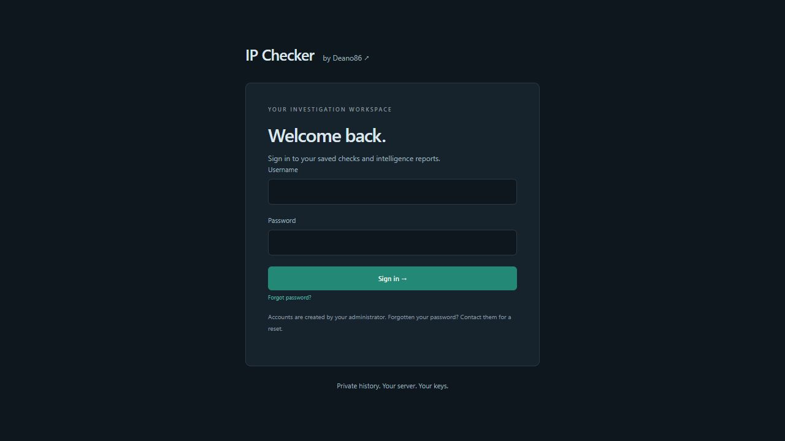](docs/screenshots/login.jpg)

[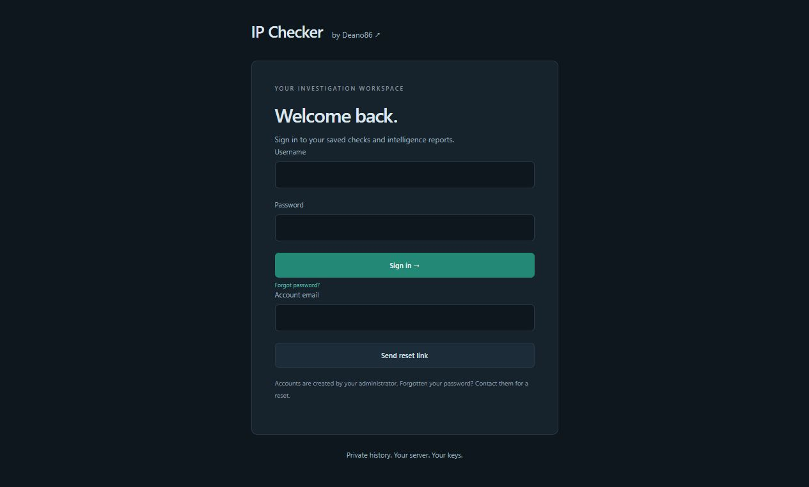](docs/screenshots/password-reset.jpg)

### Saved results

[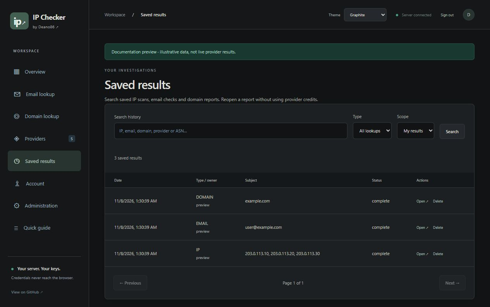](docs/screenshots/saved-results.jpg)

### Account security

[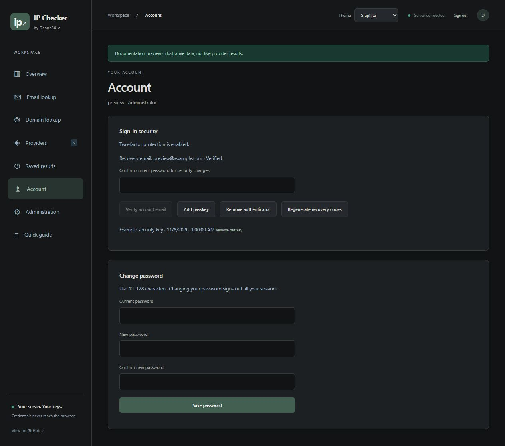](docs/screenshots/account-security.jpg)

### Administration

[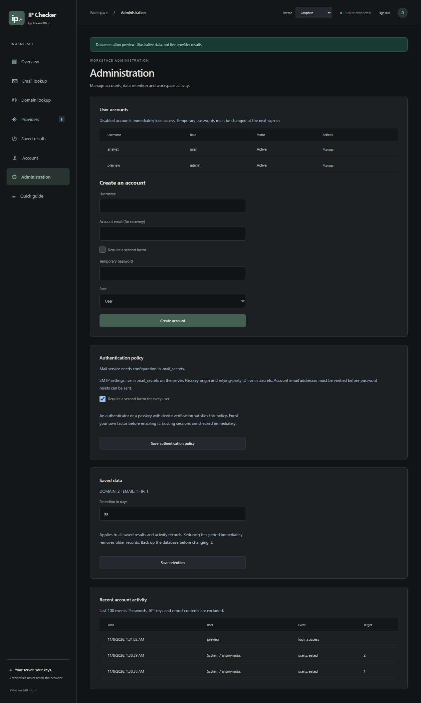](docs/screenshots/administration.jpg)

[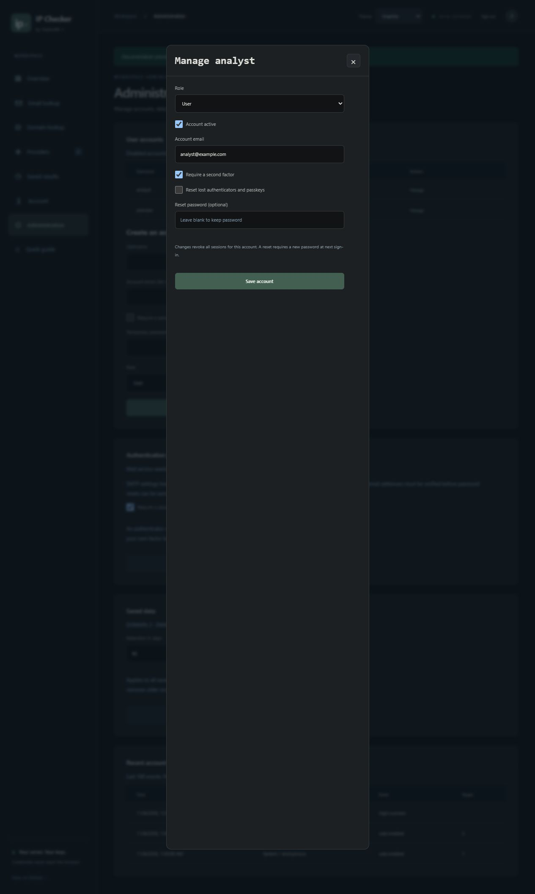](docs/screenshots/user-management.jpg)

### Overview and risk gauges

[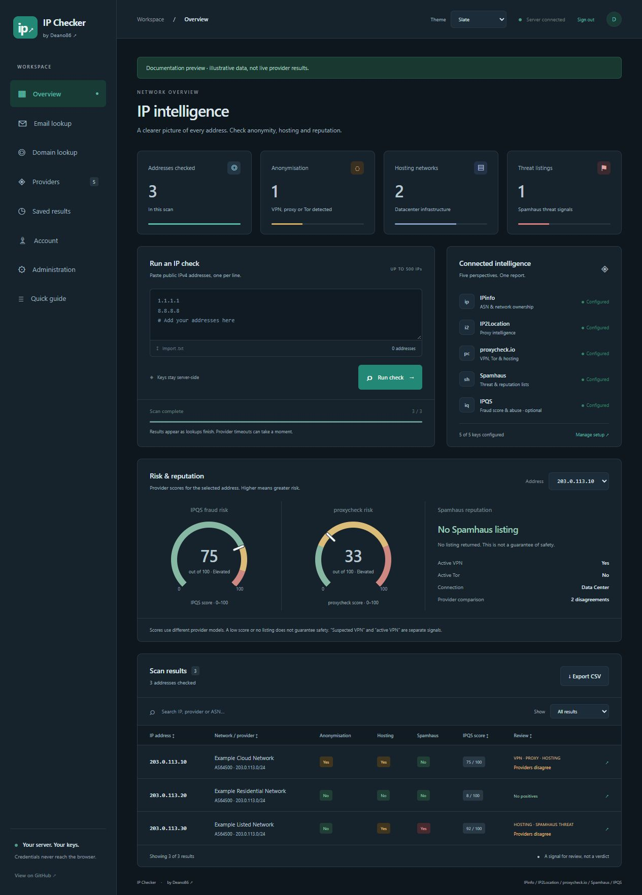](docs/screenshots/slate-overview.jpg)

### Scan-result popup

Click a scan-result row to see IPQS and proxycheck risk dials, Spamhaus status,
review flags, provider comparisons and the complete address report.

[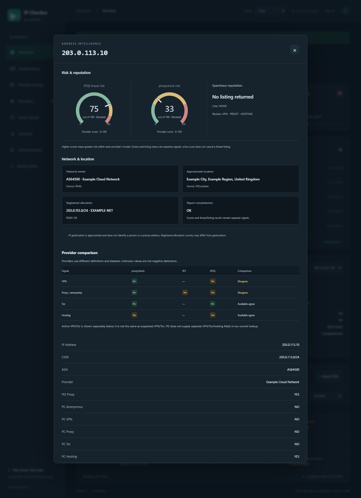](docs/screenshots/scan-result-popup.jpg)

### Email lookup

[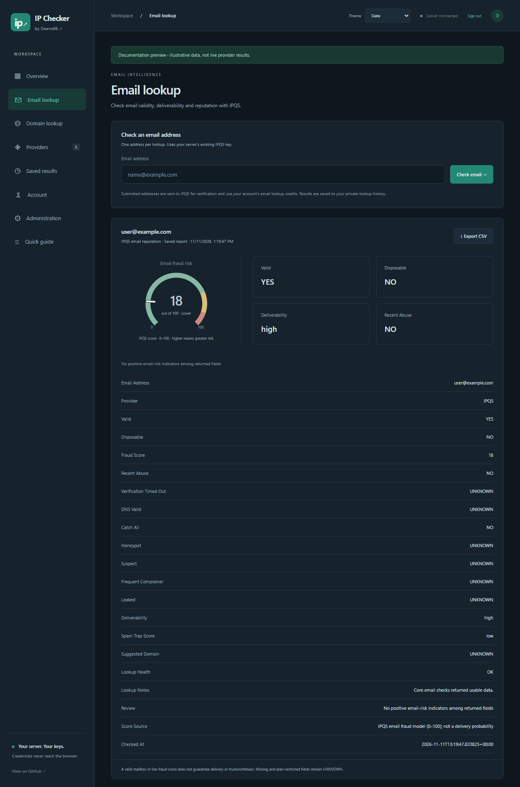](docs/screenshots/email-lookup.jpg)

### Domain lookup

[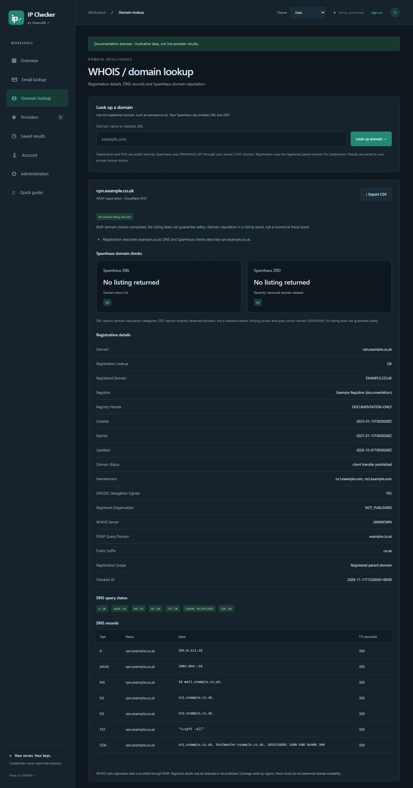](docs/screenshots/domain-lookup.jpg)

### Providers

[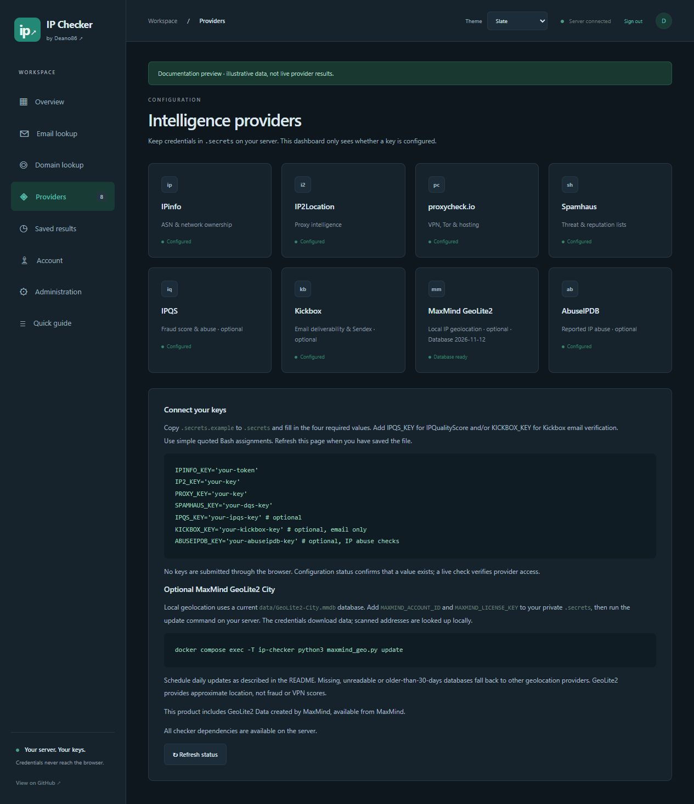](docs/screenshots/providers.jpg)

### Quick guide

[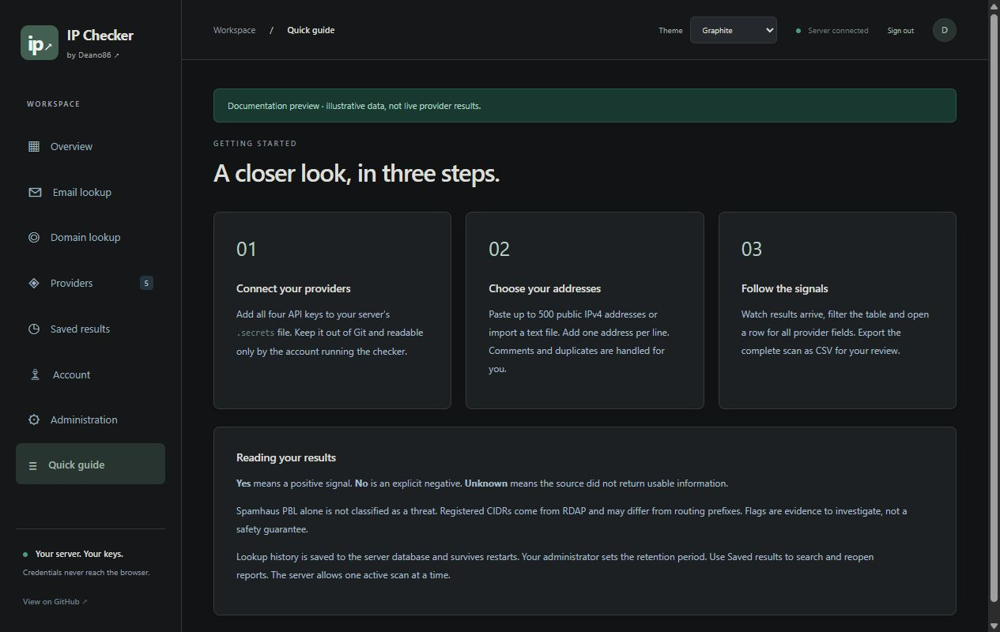](docs/screenshots/quick-guide.jpg)

### Other dark themes — full-page overviews

| Graphite | Midnight | Forest |
| :---: | :---: | :---: |
| [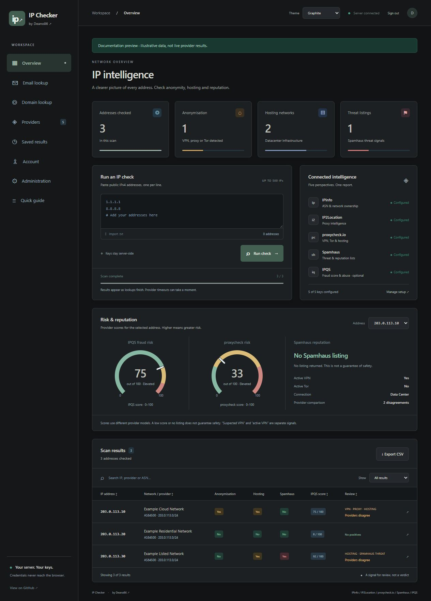](docs/screenshots/graphite-overview.jpg) | [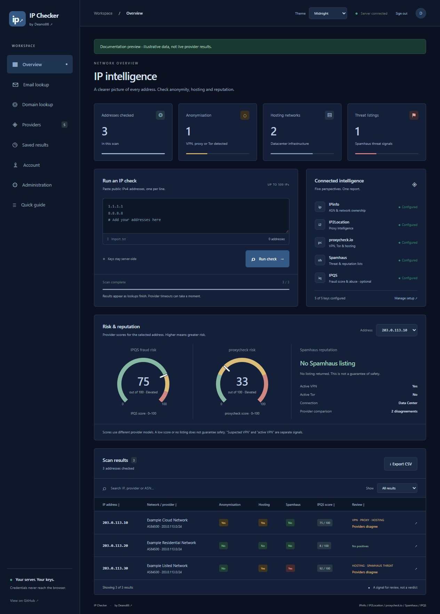](docs/screenshots/midnight-overview.jpg) | [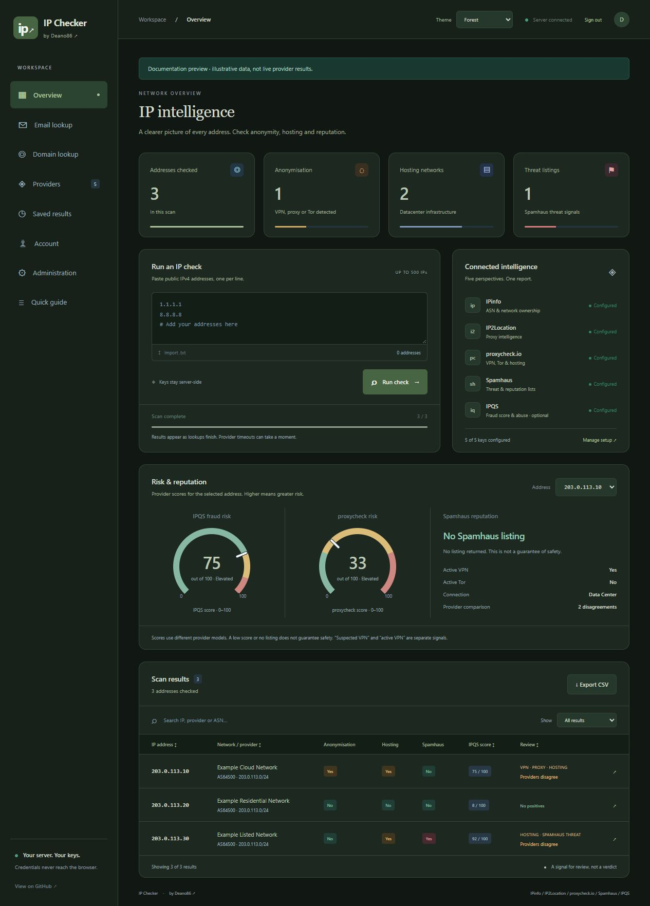](docs/screenshots/forest-overview.jpg) |

## Start the dashboard with Docker

Install Docker Engine with Compose, then:

```bash
git clone https://github.com/Deano86/ip-checker.git
cd ip-checker
umask 077
cp .env.example .env
cp .secrets.example .secrets
cp .mail_secrets.example .mail_secrets
chmod 600 .env .secrets .mail_secrets
mkdir -p data
chmod 700 data
nano .env
nano .secrets
# Optional now: configure SMTP for recovery emails.
nano .mail_secrets
LOCAL_UID="$(id -u)" LOCAL_GID="$(id -g)" docker compose up -d --build
```

Create your first administrator after the container starts. Password entry is hidden;
there is no default account or public registration:

```bash
LOCAL_UID="$(id -u)" LOCAL_GID="$(id -g)" docker compose exec ip-checker python3 dashboard.py --create-admin Deano86
```

Open **http://localhost:8080** on the server. If it runs on a remote server,
use an SSH tunnel from your own computer:

```bash
ssh -L 8080:127.0.0.1:8080 your-user@your-server
```

Then open http://localhost:8080 on your computer. The Compose port is bound
to loopback. The container reads `.secrets` through a read-only mount;
credentials are excluded from the image. `LOCAL_UID` and `LOCAL_GID` let
the container read a Linux secrets file owned by your account with mode 600.
On Docker Desktop, `docker compose up -d --build` uses the default IDs.

If the checkout already exists, run `git pull` first. If `.secrets` already
contains your keys, keep it; do not copy the empty template over it.

## Start without Docker (Linux / WSL)

After installing the dependencies below and setting up `.secrets`, run:

```bash
python3 -m venv .venv
. .venv/bin/activate
python3 -m pip install -r requirements.txt
python3 dashboard.py --create-admin Deano86
python3 dashboard.py
```

Open http://localhost:8080. Install the authentication libraries in a virtual
environment with `python3 -m pip install -r requirements.txt` before starting.
Create the first administrator with `python3 dashboard.py --create-admin Deano86`.
Bash, curl, jq, dig and Python 3 run the lookup engine behind the dashboard.

## Reading the IP, domain and email reports

IP reports now retain **58 fields**. The first 40 columns keep their original
names and order; 18 fields add provider geolocation and RDAP network registration.
The detail popup shows network ownership, approximate location, registered
allocation and provider/lookup health alongside the separate risk dials.
Old saved reports remain readable; run a fresh scan to populate the new fields.

- **Location:** country/code, region, city, timezone, latitude and longitude,
  where the provider returns them. A location bundle comes from one successful
  provider (IP2Location, then IPinfo, then IPQS), with its source shown. Missing
  or invalid coordinates remain UNKNOWN. Geolocation is approximate and is
  separate from the registered allocation's country.
- **IP registration:** registered CIDR, network name/handle, start/end range,
  allocation country, registration/update dates, status and RDAP source. The
  returned allocation must contain the submitted IP. These are registration
  records, not a guarantee of the route currently announced in BGP.
- **Scores:** IPQS IP/email fraud scores and proxycheck v3 risk scores retain
  their own models. Dials use source-specific bands: IPQS below 75 / 75–89 / 90+;
  proxycheck 0–25 / above 25–75 / above 75. These are review bands, not a fraud
  probability or an automatic block decision. Elevated/high scores add explicit
  review flags even when VPN/proxy booleans are negative. Confidence remains a
  separate value. Scores are never averaged into an invented overall score.
- **Spamhaus IP checks:** PBL alone is a policy listing, not a threat verdict.
  SBL, CSS, XBL, DROP and BCL are positive threat signals. Query errors and unknown
  return codes stay unknown/incomplete; they do not become a clean result.
- **Domain registration:** an offline, bundled Public Suffix List selects the
  registered parent, including multi-label suffixes such as co.uk. A subdomain
  lookup uses that parent for RDAP while keeping the submitted hostname for
  DNS and Spamhaus. The report names both scopes. A mismatched RDAP record is
  rejected. Updating tldextract updates the packaged suffix snapshot.
- **Domain reputation:** DBL is a domain reputation listing; ZRD is a recently
  observed-domain signal. A ZRD result alone is not a malware verdict. The
  summary distinguishes a DBL listing, recent observation, completed negative
  checks and unavailable checks; it does not assign a numerical domain score.
- **Email:** validity, disposable/catch-all flags, deliverability and fraud
  score come from IPQS. The response must explicitly confirm success. Missing
  core fields and timeouts get an incomplete-data notice; a timed-out negative
  mailbox check stays UNKNOWN. Catch-all servers cannot confirm an individual
  mailbox. The report includes a review summary, source and checked-at time.
  Reopened history is labelled Saved report rather than Fresh lookup.

An amber incomplete-data notice means data was unavailable. It does not itself
mean the IP/domain/email is malicious. Actual positive detections remain visible
independently of missing data. A negative listing check or lower score does not
guarantee safety. Provider definitions, subscriptions, limits and datasets differ.

Regression tests cover positive, negative, zero, missing/error and malformed
responses, score-only review, parent-domain scope and source attribution. Public
RDAP and keyless IP2Location responses can be checked without credentials. Tests
and documentation fixtures do not replace checking your own account's live API
access; no working API keys or private lookup results are included in the repo.

References: [IPQS IP score fields](https://www.ipqualityscore.com/documentation/proxy-detection-api/response-parameters),
[IPQS email fields](https://www.ipqualityscore.com/documentation/email-validation-api/response-parameters),
[proxycheck v3](https://proxycheck.io/api/),
[IP2Location fields](https://www.ip2location.io/ip2location-documentation),
[Spamhaus return codes](https://docs.spamhaus.com/datasets/docs/source/10-data-type-documentation/datasets/040-zones.html),
[tldextract offline suffix data](https://github.com/john-kurkowski/tldextract).

## Dashboard behaviour

- Paste or import up to 500 public IPv4 addresses, one per line.
- Run one scan at a time and watch completed results arrive.
- Search, sort, filter and open an address for all report fields, including location and network registration.
- Export all completed rows, even while a scan is running.
- Check key presence and missing dependencies in the Providers screen.

Lookup history is saved in `data/ip-checker.sqlite3` and survives container rebuilds.
Users see their own IP, email and domain reports; admins can search all users.
Saved results reopen without querying providers or consuming lookup credits.
History search covers addresses, domains, emails, ASNs, providers and report values.
Results and activity records expire after **90 days** by default. Admins can set
1–3650 days, and users can delete individual completed reports. Running scans
save completed rows; a server restart marks an interrupted scan as stopped.
An active IP scan remains limited to one across the workspace.

Provider API keys stay in `.secrets`; the browser sees presence flags only.
Login passwords are salted scrypt hashes. Session cookies are HttpOnly and
SameSite=Strict, expire after eight hours or 30 minutes of inactivity, and are
revoked by password changes, resets, account changes and disabling an account.
State-changing authenticated requests require a session CSRF token.

## Accounts, two-factor authentication and passkeys

Use **Administration** to create accounts, assign User or Administrator roles,
set recovery emails, disable access and reset temporary passwords. New accounts
must change their temporary password before using the workspace. At least one
active administrator must remain. Account changes revoke that user's sessions.

Use **Account → Sign-in security** to enrol an authenticator such as Google
Authenticator, Microsoft Authenticator or Authy. Scan the QR code or enter the
setup key, then confirm a six-digit code. Setup secrets are encrypted at rest.
Ten single-use recovery codes are displayed once: save them in a password manager.
Generating new recovery codes replaces the old ones.

Passkeys use WebAuthn with required device verification (PIN or biometrics).
In this version they are a **second factor after your password**. Add and remove
passkeys in Account; choose **Use a passkey** at the second-factor prompt.
Passkeys require a compatible browser and HTTPS, with localhost allowed for
local access or SSH tunnels. Configure these non-secret values in `.secrets`:

```bash
WEBAUTHN_RP_ID='checker.example.com'
WEBAUTHN_ORIGIN='https://checker.example.com'
# For the documented SSH tunnel, use localhost and http://localhost:8080 instead.
```

The RP ID is the exact browser hostname; the origin includes the scheme and any
non-default port. Keep this hostname stable: credentials are bound to it.

Admins can require a second factor **per account** or **for everyone**. A verified
passkey or authenticator satisfies the policy. Enrol your own factor before
turning on the global requirement. Enforcement applies to existing sessions
and every lookup, saved report and CSV endpoint. Users without a factor are
limited to enrolment; users with a factor must verify it before accessing data.
Users cannot remove their last factor while the policy requires one.

Admins can reset lost factors after checking the user's identity. This removes
authenticators, passkeys and recovery codes, revokes sessions, and preserves the
requirement to enrol again. Server-terminal recovery is also available:

```bash
docker compose exec ip-checker python3 dashboard.py --reset-password Deano86
docker compose exec ip-checker python3 dashboard.py --reset-mfa Deano86
```

The encryption key is generated in private `data/auth.key` on first startup.
Optionally provide `AUTH_ENCRYPTION_KEY` in `.secrets` as a Fernet key instead.
Keep the key with your private backups; losing or changing it makes existing
TOTP setup secrets unreadable. Never commit it or your database.

## Mail configuration and password resets

Copy `.mail_secrets.example` to **`.mail_secrets`**, mode 600, and fill it in on
the server. Compose mounts it read-only. Credentials are not editable or visible
through the dashboard. Settings are read when a message is sent:

```bash
APP_URL='https://checker.example.com'
SMTP_HOST='smtp.example.com'
SMTP_PORT='587'
SMTP_SECURITY='starttls' # or ssl with port 465
SMTP_USER='your-smtp-username'
SMTP_PASSWORD='your-smtp-password'
SMTP_FROM='IP Checker <checker@example.com>'
```

`APP_URL` must be the exact public HTTPS origin, or `http://localhost:8080` for
local access. Reset links use this configured address, never a request's Host
header. TLS certificate verification is mandatory; plaintext SMTP is unsupported.
Your mail provider may require an app password and an authorised sender domain.

An admin assigns an account email. The user then selects **Verify account email**
in Account and follows the emailed link. Only verified addresses receive password
reset links. **Forgot password?** on the login page sends a generic response for
all addresses. Reset links expire after 15 minutes, are stored as hashes, and
work only once. Verification links expire after an hour. Password resets revoke
sessions and preserve existing MFA protection. Login, code, link and recovery
requests are rate limited. Administration shows mail configuration presence and
`mail.sent` / `mail.failed` activity; actual SMTP delivery needs your own settings.

## HTTPS, persistence and upgrades

The default Compose binding stays **127.0.0.1:8080**. Use the SSH tunnel above,
or place the dashboard behind an HTTPS reverse proxy for shared access.
The dashboard is self-hosted; Sites hosting does not run this Bash/DNS engine.

### Set or change your domain

The examples below use the reserved placeholder **checker.example.com**. Replace
it with your own hostname locally. Keep domain-specific settings in the ignored
configuration files; never put your working credentials in tracked source files.

1. Point the hostname's DNS at your reverse proxy and configure a valid HTTPS
   certificate. Forward requests to the dashboard on port 8080 and preserve the
   original Host header. A proxy running directly on the same server can use
   `http://127.0.0.1:8080`; keep the default loopback Docker port binding.
   A proxy on another machine or in a separate container needs a reachable
   upstream address. Restrict upstream access to that proxy instead of exposing
   port 8080 publicly.
2. Edit `.secrets`, keeping your existing provider keys and encryption key:

   ```bash
   WEBAUTHN_RP_ID='checker.example.com'
   WEBAUTHN_ORIGIN='https://checker.example.com'
   ```

   The RP ID is a hostname only. The origin includes HTTPS and a port if using a
   non-default port. Use the address users will actually open in their browser.
3. Edit `.mail_secrets`, keeping your existing SMTP settings:

   ```bash
   APP_URL='https://checker.example.com'
   ```

   This sets the origin used in password reset and verification links.
4. Create or edit `.env` alongside `compose.yaml`, preserving unrelated settings:

   ```dotenv
   IP_CHECKER_ALLOWED_HOSTS=checker.example.com
   IP_CHECKER_SECURE_COOKIE=1
   ```

   Allowed hosts contain hostnames only, separated by commas if needed: no
   scheme, path or port. Secure cookies require HTTPS. Leave the flag at 0 only
   for the local HTTP/SSH-tunnel setup.
5. Apply the configuration from the checkout directory:

   ```bash
   chmod 600 .env .secrets .mail_secrets
   unset IP_CHECKER_ALLOWED_HOSTS IP_CHECKER_SECURE_COOKIE
   LOCAL_UID="$(id -u)" LOCAL_GID="$(id -g)" docker compose up -d --force-recreate
   docker compose exec ip-checker printenv IP_CHECKER_ALLOWED_HOSTS IP_CHECKER_SECURE_COOKIE
   ```

   The last command should print the configured hostname and `1`. Existing
   exported shell variables override `.env`; the `unset` step clears stale
   examples. See [Docker's interpolation precedence documentation](https://docs.docker.com/compose/how-tos/environment-variables/variable-interpolation/).
   Changing Python files also requires `--build`, as shown in the upgrade
   instructions below.
6. Open the new HTTPS URL and sign in. Existing passkeys are bound to the old
   hostname and must be enrolled again at the new domain. Authenticator-app
   codes and the database encryption key do not need changing. If necessary,
   use an authenticator or recovery code to access Account and enrol a new
   passkey; server-terminal recovery is documented above.

If the page returns **Host or origin is not allowed**, verify the environment
inside the running container using step 5, then check that the proxy preserves
the browser-facing Host header. Test the application directly on the server:

```bash
curl -s -o /dev/null -w '%{http_code}\n' \
  -H 'Host: checker.example.com' http://127.0.0.1:8080/login
```

Expect `200`. This checks HTTP access without submitting a password. The Python
server does not implement HEAD requests, so use the GET request above rather
than `curl -I`. Apply connection and request-rate limits at the reverse proxy
for a public-facing installation.

### Access logs

HTTP access events are written to standard output as one JSON line per response.
They appear immediately when refreshing a page:

```bash
docker compose logs --tail=100 ip-checker
docker compose logs -f --tail=50 ip-checker
```

Press Ctrl+C to stop following. Each event includes `http_access`, the timestamp,
network peer, method, route and HTTP status. Query strings, request bodies,
headers, passwords, resource identifiers and unrecognised paths are excluded.
Logs distinguish `peer` (the direct network connection) from `client_ip`
(the resolved visitor address). Both are the same for a direct request.

#### Visitor IPs with Nginx Proxy Manager

Nginx Proxy Manager already sets `X-Forwarded-For` and appends its connection's
remote address; see its [standard proxy configuration](https://github.com/NginxProxyManager/nginx-proxy-manager/blob/develop/docker/rootfs/etc/nginx/conf.d/include/proxy.conf).
The app accepts this header only when the socket peer is explicitly trusted.

Add the backend-facing IP of your NPM instance to your local `.env`. This example
uses a reserved documentation address: replace it with the `peer` address shown
in your logs **after confirming that it belongs to your proxy**:

```dotenv
IP_CHECKER_TRUSTED_PROXIES=192.0.2.10/32
```

Use exact addresses (`/32` for IPv4, `/128` for IPv6) where possible. Multiple
proxy addresses or dedicated proxy networks can be comma-separated. Do not
trust all addresses or a network that includes ordinary visitors. Leaving
the setting empty keeps forwarded headers disabled.

After pulling this update and preserving any local port-binding changes, apply:

```bash
unset IP_CHECKER_TRUSTED_PROXIES
LOCAL_UID="$(id -u)" LOCAL_GID="$(id -g)" docker compose up -d --build --force-recreate
docker compose exec ip-checker printenv IP_CHECKER_TRUSTED_PROXIES
docker compose logs -f --tail=50 ip-checker
```

Refresh through NPM and look at `client_ip`; `peer` continues to identify the
proxy. A direct request with a forged header cannot change `client_ip`.
The app walks the forwarded chain right to left and stops at the first
untrusted hop, ignoring any earlier spoofed entries. Invalid entries in the trusted portion of the chain, or oversized
headers, fall back to the direct peer. This setting affects access-log
attribution; it does not grant host access or change authentication.

If NPM is behind another proxy, trust each verified proxy hop needed to resolve
the visitor. Otherwise the next untrusted proxy is correctly reported as the
client. If the visitor still cannot be resolved, inspect NPM's own access logs
and its generated proxy-host configuration; it must forward `X-Forwarded-For`.
Avoid adding duplicate `proxy_set_header` directives to NPM's Advanced box. Login and account events remain available in
**Administration → Recent account activity**.

### Upgrade an existing installation

Upgrade an existing checkout without replacing provider keys:

```bash
cd ~/ip-checker
git pull
umask 077
[ -f .env ] || cp .env.example .env
[ -f .mail_secrets ] || cp .mail_secrets.example .mail_secrets
mkdir -p data
chmod 700 data
chmod 600 .env .secrets .mail_secrets
LOCAL_UID="$(id -u)" LOCAL_GID="$(id -g)" docker compose up -d --build
LOCAL_UID="$(id -u)" LOCAL_GID="$(id -g)" docker compose exec ip-checker python3 dashboard.py --create-admin Deano86
```

Run `--create-admin` only once for a new username. Existing scans from versions
that held history only in memory cannot be recovered after a restart. The new
`data/` directory must be writable by the configured container UID, and kept
private. Docker Desktop users should also create `data/` and both secrets files
before starting Compose.

Back up the complete `data/` directory plus both secrets files privately. Stop
the container during a filesystem backup so the SQLite database, WAL and encryption
key remain consistent, or use SQLite's online backup API. Restore with the same
file owner and restrictive permissions. Backups contain personal lookup history
and authentication data. Stop with `docker compose down`; bind-mounted data remains.
Never put these backups in the public repository or Docker build context.

## CLI install (Ubuntu / Debian)

Requires Bash 4.3+, curl, jq, dig and Python 3. Run it on Linux or in WSL.

```bash
sudo apt-get update
sudo apt-get install -y git curl jq dnsutils python3
git clone https://github.com/Deano86/ip-checker.git
cd ip-checker
umask 077
cp .secrets.example .secrets
chmod 600 .secrets
nano .secrets
cp ip-addresses.example.txt ip-addresses.txt
nano ip-addresses.txt
bash ip-checker.sh
```

The repository is public; no account passwords, database or working API keys are included.
Use your own keys from your provider accounts, with access to the queried
endpoints. No keys are included in this repository.

## Secrets

All four keys go in the **local `.secrets` file**, next to the script:

```bash
IPINFO_KEY='your-ipinfo-token'
IP2_KEY='your-ip2location-key'
PROXY_KEY='your-proxycheck-key'
SPAMHAUS_KEY='your-spamhaus-dqs-key'
IPQS_KEY='your-ipqualityscore-key' # optional
```

`.secrets` is ignored by Git. Only the empty `.secrets.example` template is
committed. Input lists, CSV reports and the original separate token filenames
are also ignored. Do not force-add these files. If a key has already been
committed elsewhere, revoke it with its provider; ignoring a file does not
remove it from history.

The configuration is sourced as Bash code: use only a file you control.
Keep it readable only by the account running the script (`chmod 600`).
To keep it outside the checkout:

```bash
IP_CHECKER_SECRETS=/secure/path/.secrets bash ip-checker.sh
```

## Usage

```bash
bash ip-checker.sh [input-file [output-csv]]
bash ip-checker.sh /root/ip-addresses.txt /root/ip-results.csv
```

Defaults are `ip-addresses.txt` and `ip-results.csv` beside the script,
regardless of the current working directory. An existing output is replaced
on each run. The output cannot be the input or secrets file. Files created
by the script use a restrictive umask.

Input accepts one public IPv4 address per line, optional `#` comments, blank
lines and duplicates. IPv6 and invalid/non-public addresses are skipped.

`YES` means a positive detection; `NO` means an explicit negative;
`UNKNOWN` means unavailable, missing or unrecognised data. Anonymisation
is `YES` if any source is positive, `UNKNOWN` if no source is positive and
any detection is unknown, and `NO` only when all checked signals are negative.
`INCOMPLETE` marks otherwise unflagged rows with unknown classification data.
Rows with positive flags can also contain unknown fields; inspect the columns.
The incomplete summary counts rows labelled `INCOMPLETE`.

Spamhaus PBL alone is not treated as a threat listing. SBL, CSS, XBL and
DROP are threat flags. RDAP CIDRs describe registered allocations, not
necessarily currently announced routing prefixes. Results support manual
review and are not a guarantee that an address is safe or malicious.

Requests send each address to the listed services and applicable RDAP
registries. API failures and rate limits produce unknown results. Paid
subscriptions, provider quotas and Spamhaus DQS resolver access may be
required. Lookups run sequentially with bounded per-request timeouts.

## Checks

GitHub Actions runs Bash and JavaScript syntax checking and offline regression tests with
mock responses. It does not require API keys or perform live provider lookups.

```bash
bash -n ip-checker.sh
node --check web/app.js
python3 -m unittest discover -s tests -v
```

## IPQualityScore (IPQS)

Add `IPQS_KEY='your-key'` to your existing `.secrets` file to enable IPQS.
Keep the four original provider keys. An empty or missing IPQS key disables
only IPQS and does not prevent scans. Rebuild after pulling this update:

```bash
git pull
nano .secrets
LOCAL_UID="$(id -u)" LOCAL_GID="$(id -g)" docker compose up -d --build
```

The dashboard shows IPQS configuration status and a fraud score column.
Per-address details and CSV contain lookup status, fraud score (0–100),
proxy, VPN, Tor, recent abuse and bot flags. The first 19 CSV columns stay
in the same order; seven IPQS columns are appended. Older saved CSVs are
unchanged. New scans are needed to populate IPQS results.

IPQS positives contribute to anonymisation and VPN/Tor/proxy review flags.
Recent abuse and bot detections add `IPQS_RECENT_ABUSE` and `IPQS_BOT` review
flags; the Spamhaus threat column stays specific to Spamhaus. The fraud
score is shown as returned and does not impose an automatic blocking rule.
Invalid keys, provider failures, quota errors and missing fields stay unknown;
an otherwise unflagged scan row is incomplete when enabled IPQS data is missing.
`NOT_CONFIGURED` means IPQS was skipped; `OK` means a successful API response;
`ERROR` means it did not return a successful response.

Authentication uses the server-side `ipqs-key` request header, following
[IPQS authentication documentation](https://www.ipqualityscore.com/documentation/about-ipqs-apis/submitting-data-to-ipqs-apis).
Field meanings follow the [IPQS response reference](https://www.ipqualityscore.com/documentation/proxy-detection-api/response-parameters).
Live lookups consume your IPQS account's quota.

## Provider diagnostics and fallback data

New scans include provider statuses, ASN/provider sources and a separate
`Lookup Health` column. `PARTIAL` is shown even on rows with positive review
flags, and the Incomplete filter includes these rows. Missing or blank fields
display as `UNKNOWN`. Successful detections remain visible when another
provider fails.

Network identity uses IPinfo's legacy response, then its Lite API when the
legacy organisation field is absent. If unavailable, it uses valid fields
from IP2Location, proxycheck.io and IPQS in that order. ASN and provider each
show their source. Fallback data does not hide failed-provider diagnostics.
The Lite fallback adds one request only when the legacy field is missing.

| Status | Action |
| --- | --- |
| `AUTH_ERROR` | Check that provider's key in `.secrets`. |
| `ACCESS_DENIED` | Check the key, endpoint access, account plan and provider restrictions. |
| `RATE_LIMIT_OR_QUOTA` | Check the provider's usage/credits and retry after the applicable limit resets. |
| `AUTH_OR_QUOTA_ERROR` | IP2Location code 10000 combines invalid-key and exhausted-query conditions; check both in your account. |
| `TIMEOUT` / `NETWORK_ERROR` | Check server DNS, connectivity and outbound HTTPS access. |
| `MISSING_NETWORK_FIELDS` / `MISSING_PROXY_FIELD` | The response lacks required data; check endpoint/plan access. |
| `INVALID_JSON` / `INVALID_RESPONSE` | The provider returned unusable data. |

Statuses are classified from HTTP codes and provider responses. Raw error
messages, response bodies, URLs and credentials are not exposed in reports.
An IPinfo diagnostic lists both legacy and Lite outcomes when fallback runs.
The original 26 columns retain their order; seven diagnostic columns are appended.
Old scan reports are not re-enriched: run a new scan after rebuilding.

## Risk gauges and provider comparison

The Risk & Reputation panel shows speedometer-style gauges for the selected
address's IPQS fraud score and proxycheck risk score. Both use their original
0–100 scale, where higher means higher risk. They are separate provider
models, not interchangeable scores or probabilities. Missing scores show
an empty grey gauge labelled Unknown, never a misleading zero. Spamhaus
reputation is shown as a listing status rather than an invented numeric score.

Choose an address in the panel, or open a result to select its gauges.
The detail view compares VPN, proxy/anonymity, Tor and hosting by provider.
Explicit YES/NO differences are highlighted and can be filtered using
Providers disagree. Unknown and unsupported fields do not count as negative
votes. Anonymity comparison includes proxycheck's anonymous/VPN/proxy/Tor
signals because IPQS and IP2 proxy flags cover anonymity more broadly.
Hosting comparison uses proxycheck hosting against IPQS connection type.
Provider definitions differ; a disagreement does not establish which is correct.

Seven more IPQS fields are appended to the original 33 report columns:
active VPN, active Tor, connection type, abuse frequency, verified crawler,
hostname and country code. These are taken from the existing IPQS response;
no additional endpoint or lookup call is added. Plan-restricted or absent
context fields remain UNKNOWN and do not by themselves make lookup health
partial. Active VPN/Tor positives contribute to the corresponding review flags.
Suspected VPN/Tor and active VPN/Tor are kept separate in the report.
Crawler identification provides context and never suppresses other detections.

After pulling and rebuilding, run a new scan to populate the new fields.
Saved history and lookup caching are not included in this update.

## Email lookup and dark mode

Use **Email lookup** in the sidebar to check one email address with IPQS.
It uses the same `IPQS_KEY` from `.secrets`, independently of the four
required IP scan providers. Your IPQS account must have email API access
and available email lookup credits. Submitted addresses are sent to IPQS
using a server-side HTTPS POST; the API key is sent in a request header.
No email is sent by the dashboard itself.

The report includes validity, disposable status, fraud risk, deliverability,
recent abuse, DNS/catch-all signals and other selected reputation fields.
Absent or plan-restricted fields remain UNKNOWN. A timed-out mailbox check
does not become a confirmed invalid address. The report can be exported to
CSV; email input/results are not persisted to disk or browser storage.

Dark mode is the default. The top bar has a Theme menu with four dark palettes
and an optional Light appearance; the browser remembers your selection.
The theme is applied before the page
styles load to minimise a white flash. Existing IP scan behaviour is preserved.

Reference: [IPQS email verification](https://www.ipqualityscore.com/documentation/email-validation-api/overview).

## WHOIS / domain lookup

Choose Domain lookup in the sidebar to retrieve public registration information
using RDAP and query DNS records through Cloudflare's DNS-over-HTTPS resolver.
No API key is required. Enter a registered domain such as `example.com` or
`example.co.uk`; HTTP(S) URLs are accepted and reduced to their hostname.
International domain names are normalised to IDNA ASCII. IP literals are rejected.

The registration report includes registrar, creation/expiration/update dates,
status, nameservers, DNSSEC delegation status and registrant organisation when
published. Personal details may be withheld. RDAP support varies by registry;
subdomains may have no separate registration record. No raw port-43 WHOIS
connection is made. DNS queries cover A, AAAA, MX, NS, TXT, CNAME and SOA.

Registration and DNS queries run independently in parallel. Missing records,
NXDOMAIN, unsupported registration, rate limits and network errors are shown
separately. These results are not a domain-availability check. Registration,
DNS records and query statuses can be exported together as CSV. The dashboard
does not save domain lookup history.

Queries are sent to RDAP.org and its public HTTPS registry referrals, and to
Cloudflare DNS. Lookups do not visit the submitted website. Registry data is
displayed as text; private/insecure RDAP redirects are rejected.

References: [RDAP.org](https://about.rdap.org/),
[Cloudflare DNS JSON API](https://developers.cloudflare.com/1.1.1.1/encryption/dns-over-https/make-api-requests/dns-json/).

## Spamhaus domain reputation: DBL and ZRD

Domain lookups now also query Spamhaus **DBL** (domain reputation) and
**ZRD** (domains first observed within the past 24 hours). They use your
existing `SPAMHAUS_KEY` in `.secrets`, through `dig` and the server's DNS
resolver. Your DQS account must permit both datasets. Registration and
public DNS lookups still work without a Spamhaus key; those checks then
show NOT_CONFIGURED. Keyed Spamhaus queries are not sent to the public
Cloudflare DNS-over-HTTPS endpoint used for ordinary DNS records.

DBL reports each returned category, including phishing, malware, botnet
command-and-control and abused legitimate domains. These categories are
kept distinct. ZRD reports the first-observed age band; a positive ZRD
result does not mean that the domain is malicious. These checks query the
submitted hostname, not every parent domain, linked URL or resolved IP.
The existing IP scan still checks Spamhaus ZEN separately.

Only a successful NXDOMAIN response is treated as no listing. DNS failures,
empty answers, query/access error codes and unexpected replies stay UNKNOWN.
The keyed query name and raw DNS output are never included in API responses,
browser results or CSV exports. CSV exports include statuses, listing values,
categories and safe return codes. Enabled checks that fail mark lookup health
as PARTIAL. An unlisted domain is not guaranteed safe; no automatic blocking is added.

After updating the image, run a new domain lookup. No new key variable is needed.
References: [Spamhaus DQS queries](https://docs.spamhaus.com/datasets/docs/source/70-access-methods/data-query-service/040-dqs-queries.html),
[DBL and ZRD return codes](https://docs.spamhaus.com/datasets/docs/source/10-data-type-documentation/datasets/040-zones.html).

References: [IPinfo Lite response fields](https://ipinfo.io/developers/lite-api),
[IP2Location response fields and error codes](https://www.ip2location.io/ip2location-documentation).
